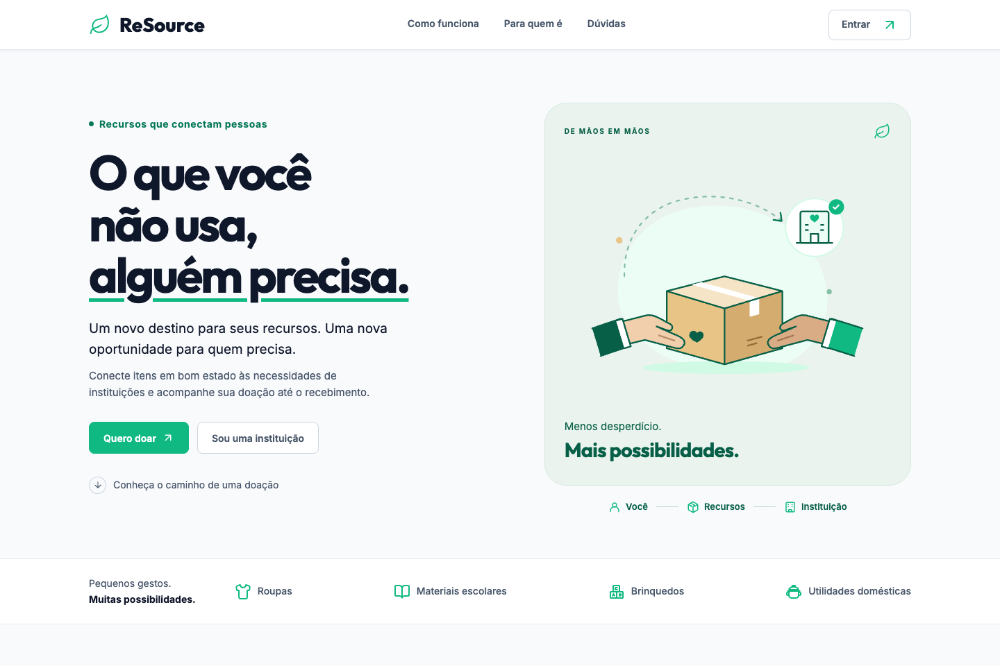
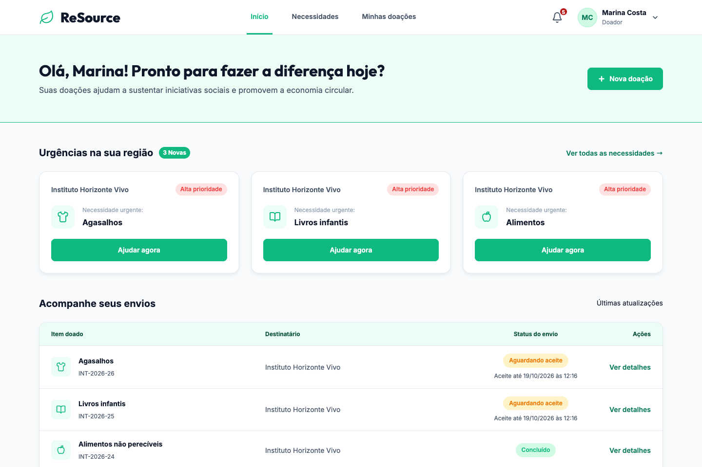
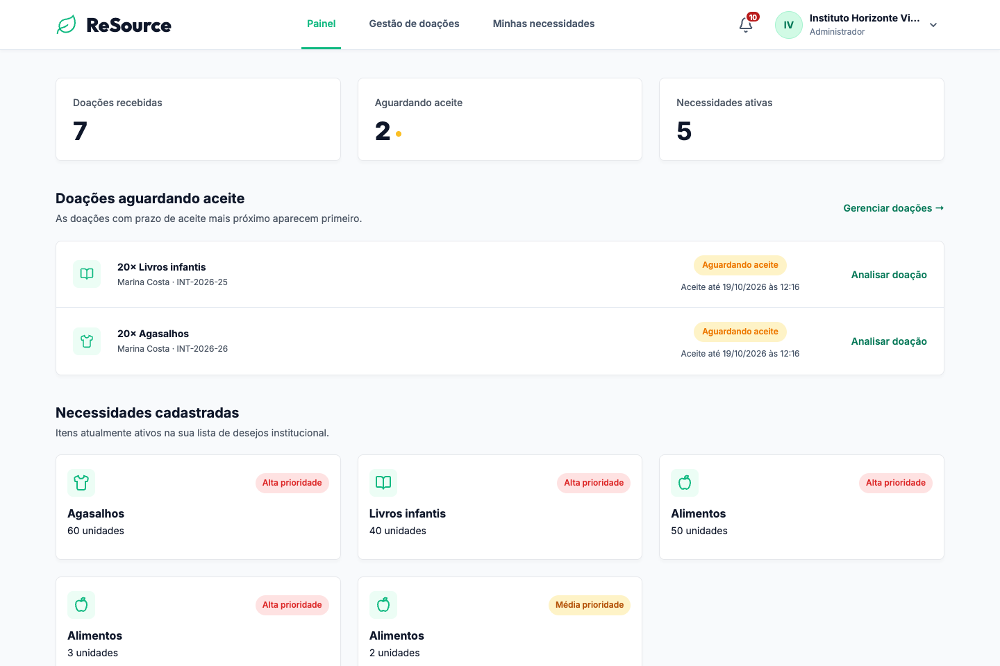

<div align="center">
  
  <h1>ReSource</h1>
  <p><strong>O que você não usa, alguém precisa.</strong></p>
  <p>Recursos em bom estado. Necessidades reais. Doações acompanhadas até o recebimento.</p>
  <p>
    <a href="#o-produto">O produto</a> ·
    <a href="#experiência">Experiência</a> ·
    <a href="#executar-localmente">Executar localmente</a> ·
    <a href="#documentação">Documentação</a>
  </p>
</div>



## O produto

O **ReSource** conecta doadores às necessidades de organizações sociais. A plataforma reúne a descoberta de necessidades, as propostas de doação e o acompanhamento da entrega em um só lugar, dando visibilidade ao andamento de cada contribuição.

| Para quem doa | Para quem recebe |
| --- | --- |
| Consultar necessidades por categoria, prioridade e estado. | Consultar necessidades e propostas da instituição. |
| Cadastrar itens e oferecer uma quantidade disponível. | Aceitar ou recusar propostas, com registro do motivo. |
| Escolher entrega presencial ou envio pelos Correios. | Acompanhar a entrega e consultar o rastreamento informado. |
| Acompanhar atualizações, prazos e histórico da doação. | Conferir os itens e confirmar o recebimento. |

### Da intenção ao recebimento

1. **Encontrar uma necessidade.** O doador escolhe onde contribuir e envia uma proposta com os itens e a quantidade oferecida.
2. **Avaliar a proposta.** A instituição analisa a contribuição e aceita ou recusa a oferta.
3. **Organizar a entrega.** Após o aceite, o doador escolhe a modalidade e informa a entrega presencial ou a postagem com rastreamento.
4. **Confirmar o recebimento.** A instituição confere o recebimento e conclui a doação. As etapas ficam registradas no histórico.

As quantidades são reservadas durante o fluxo para evitar ofertas acima do saldo disponível. Os prazos orientam as próximas ações; propostas vencidas são canceladas e suas reservas liberadas.

### Acesso e acompanhamento

- **Conta de doador:** cadastro com e-mail e senha ou autenticação com Google, quando habilitada.
- **Conta institucional:** solicitação com CNPJ, dados do representante e documentos privados para análise. O acesso depende de aprovação.
- **Recuperação de acesso:** link de uso único enviado por e-mail para contas cadastradas com senha.
- **Notificações:** atualizações no cabeçalho e por e-mail, conforme a configuração de envio.
- **Continuidade:** links protegidos são retomados após o login, respeitando as permissões da conta.

## Experiência

Uma interface responsiva organiza necessidades, propostas e entregas por perfil. Os formulários incluem validação, feedback de senha, preenchimento automático e navegação por teclado.

As capturas abaixo mostram a aplicação com **dados fictícios em um ambiente de demonstração**.

### Painel do doador

Necessidades prioritárias e as últimas atualizações das doações, com acesso aos detalhes de cada envio.



### Painel da instituição

Visão das propostas pendentes, dos recebimentos e das necessidades disponíveis para doação.



## Tecnologia

| Camada | Tecnologias |
| --- | --- |
| Aplicação | Java 25 · Spring Boot 4.1.1 |
| Interface | Thymeleaf · HTML · CSS · JavaScript |
| Autenticação | Spring Security · OAuth 2.0 / OpenID Connect |
| Persistência | PostgreSQL · Spring Data JPA · Flyway |
| Eventos e notificações | RabbitMQ · outbox transacional · SMTP |
| Verificação | JUnit · Testcontainers · JaCoCo · PIT |

A interface é renderizada pelo servidor. As operações do fluxo de doação usam endpoints JSON, com validação e autorização no backend. Eventos persistidos em outbox integram as atualizações da doação às notificações e ao envio de mensagens.

## Executar localmente

### Pré-requisitos

- Java 25 instalado e disponível no terminal.
- Docker em execução, com Docker Compose disponível.
- Portas `8080`, `5432`, `5672` e `15672` livres para a configuração padrão.

O repositório inclui o Maven Wrapper; não é necessário instalar o Maven separadamente.

### 1. Preparar a configuração

Na raiz do repositório:

```bash
cp .env.example .env
```

Ajuste as credenciais de PostgreSQL e RabbitMQ no `.env`. A referência das variáveis está em [`.env.example`](.env.example).

O Spring importa esse arquivo como propriedades: use `CHAVE=valor`, sem `export` e sem aspas envolvendo os valores. Execute a aplicação a partir da raiz do projeto. Variáveis de ambiente do processo têm prioridade sobre o arquivo; reinicie a aplicação após alterar a configuração. O `.env` não deve ser versionado.

### 2. Iniciar a aplicação

```bash
./mvnw spring-boot:run
```

A integração com Docker Compose inicia o PostgreSQL e o RabbitMQ definidos em [`compose.yaml`](compose.yaml). O Flyway aplica as migrações de banco durante a inicialização.

| Acesso local | Endereço |
| --- | --- |
| ReSource | [localhost:8080](http://localhost:8080) |
| Gerenciamento do RabbitMQ | [localhost:15672](http://localhost:15672) |
| Swagger UI | [localhost:8080/swagger-ui.html](http://localhost:8080/swagger-ui.html) |
| Especificação OpenAPI | [localhost:8080/v3/api-docs](http://localhost:8080/v3/api-docs) |

A documentação da API exige autenticação. O gerenciamento do RabbitMQ utiliza as credenciais configuradas no `.env`.

### 3. Habilitar integrações opcionais

| Integração | Configuração |
| --- | --- |
| Login Google | Configure `GOOGLE_CLIENT_ID` e `GOOGLE_CLIENT_SECRET`, ative `GOOGLE_LOGIN_ENABLED` e autorize o callback `/login/oauth2/code/google` no cliente OAuth. |
| Recuperação e e-mails transacionais | Configure as variáveis `MAIL_*`, o remetente e o servidor SMTP; ative `MAIL_ENABLED`. |
| Notificações por e-mail | Controle os envios com `NOTIFICATION_EMAIL_ENABLED`; o SMTP compartilhado também precisa estar habilitado. |
| Links nos e-mails | Defina `APP_BASE_URL` com a URL da aplicação, como `http://localhost:8080` no desenvolvimento. |

O exemplo mantém Google e SMTP desativados, permitindo iniciar o projeto sem credenciais desses serviços. A consulta de CNPJ utiliza a BrasilAPI; os documentos institucionais ficam no diretório privado definido por `INSTITUTION_DOCUMENT_DIRECTORY`.

## Verificar e empacotar

Com o Docker em execução:

```bash
./mvnw verify
```

O comando executa os testes existentes com dependências isoladas via Testcontainers e gera o relatório de cobertura em `target/site/jacoco/index.html`.

Para gerar o pacote:

```bash
./mvnw package -DskipTests
```

O JAR é produzido em `target/`. O projeto também inclui um [`Dockerfile`](Dockerfile) para construção da imagem da aplicação.

<details>
  <summary>Testes de mutação</summary>

```bash
./mvnw pitest:mutationCoverage
```

Os relatórios são gerados em `target/pit-reports/`.

</details>

## Documentação

| Conteúdo | Referência |
| --- | --- |
| Índice da documentação | [`docs/README.md`](docs/README.md) |
| Requisitos funcionais | [`docs/requisitos-funcionais/`](docs/requisitos-funcionais/) |
| Regras de negócio | [`docs/regras-de-negocio/`](docs/regras-de-negocio/) |
| Casos de uso | [`docs/casos-de-uso/`](docs/casos-de-uso/) |
| Arquitetura | [`docs/arquitetura/arquitetura.md`](docs/arquitetura/arquitetura.md) |
| Configuração de referência | [`.env.example`](.env.example) |

## Organização do repositório

```text
resource-system/
├── src/
│   ├── main/java/       Backend da aplicação
│   ├── main/resources/ Templates, estilos, scripts e migrações
│   └── test/           Testes e configuração do Testcontainers
├── docs/               Documentação de negócio e arquitetura
├── .env.example        Referência das variáveis de ambiente
├── compose.yaml        Serviços de desenvolvimento
├── Dockerfile          Imagem da aplicação
└── pom.xml             Dependências e build
```
